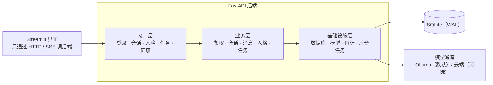

# AI 智能伴侣

> 一个完整形态的 AI 对话应用：后端分层、前端只走 HTTP、数据按用户隔离，默认全本地运行。


## 这个项目解决什么

多数对话类项目停在"能聊"：一个脚本直接连模型、一个界面直接连数据库。真要做成一个小产品，会遇到另一类问题——用户是谁、数据归谁、流式怎么推、出错怎么表达、后台任务怎么跟踪、表结构怎么演进。

这个项目把这些工程问题补齐：FastAPI 三层后端（接口 / 业务 / 基础设施 + 核心配置），界面只通过 HTTP 调后端；注册登录、按用户隔离数据、SSE 流式输出、统一错误结构、请求 ID 贯穿日志、限流、幂等、后台导出任务、审计留痕、版本化迁移。

## 功能概览

| 能力 | 说明 |
| --- | --- |
| 分层后端 | 接口层只做参数解析与响应组装，业务层管规则与归属校验，基础设施层封装数据库、模型、审计、任务 |
| 注册登录 | 本地账号体系：密码哈希存储、不透明令牌，登录态校验统一在依赖注入里 |
| 数据隔离 | 会话、消息、人格、任务都按用户归属校验；访问他人资源返回 403 并记审计 |
| SSE 流式对话 | 逐段推送增量文本，结束后整体落库，前端可边收边渲染 |
| 统一错误 | 业务异常输出固定字段（错误码、说明、请求 ID），未知异常不泄漏堆栈 |
| 可观测 | 每个请求生成请求 ID，结构化日志记录方法、路径、状态、耗时，贯穿模型调用 |
| 限流 | 进程内滑动窗口，按用户与时间窗计数，超限返回 429 |
| 幂等任务 | 导出任务带幂等键，重复提交返回同一个任务 |
| 后台任务 | 异步执行导出，状态在排队、运行、成功、失败之间流转，失败如实暴露 |
| 审计日志 | 登录、会话增删、越权、发消息、任务状态变化都留痕 |
| 版本化迁移 | 迁移脚本管理全部表结构，启动时自动升级到最新 |
| 双模型通道 | 默认本地 Ollama，一键切换到云端备选，超时与重试统一封装 |

## 架构



## 技术栈

| 层 | 选型 |
| --- | --- |
| 后端 | FastAPI + Pydantic + SQLAlchemy |
| 迁移 | Alembic，启动时自动升级 |
| 前端 | Streamlit，仅作客户端 |
| 存储 | SQLite（WAL 模式） |
| 模型 | 本地 Ollama（默认）；云端备选可切换 |
| 工程化 | 请求 ID 日志、统一异常、限流、幂等、审计、CI |

## 目录结构

```
.
├── backend/
│   ├── main.py               # 应用工厂：中间件、异常、路由、启动迁移
│   ├── api/                  # auth / conversations / personas / jobs / health
│   ├── service/              # 鉴权、会话、消息、人格、任务等业务规则
│   ├── infrastructure/       # 数据库、模型通道、审计、后台任务
│   ├── core/                 # 配置、安全、日志、异常、依赖注入
│   ├── schemas/              # 请求与响应模型
│   └── alembic/              # 版本化迁移
├── app/                      # Streamlit 前端与后端 HTTP 客户端
├── presets/                  # 人格预设
├── scripts/                  # 初始化、端到端自检
├── tests/                    # 接口、业务、模型客户端、存储
├── 创作资源/                 # 人格形象与演示素材
└── requirements.txt / Dockerfile / start.ps1
```

## 快速开始

前置：Ollama 已运行并拉取对话模型。

```powershell
ollama pull qwen3.5:9b
```

```powershell
python -m pip install -r requirements.txt
copy .env.example .env
.\start.ps1
```

`start.ps1` 会同时拉起后端与前端；也可以分两个终端手动启动：

```powershell
# 终端 1：后端（首次启动自动建表与写入人格预设）
$env:PYTHONPATH="."
python -m uvicorn backend.main:app --port 8001

# 终端 2：前端
python -m streamlit run app/main.py --server.port 8511
```

打开 `http://localhost:8511`，注册账号、新建会话即可对话。

## 主要接口

| 方法 | 路径 | 说明 |
| --- | --- | --- |
| POST | `/api/auth/register` `/api/auth/login` | 注册 / 登录，返回访问令牌 |
| GET | `/api/auth/me` | 当前用户 |
| GET | `/api/personas` | 人格预设列表 |
| POST / GET | `/api/conversations` | 新建 / 列出本人会话 |
| GET / PATCH / DELETE | `/api/conversations/{id}` | 会话详情 / 更新 / 删除 |
| GET | `/api/conversations/{id}/messages` | 历史消息 |
| POST | `/api/conversations/{id}/messages/stream` | SSE 流式对话 |
| POST | `/api/conversations/{id}/files` | 上传文本上下文 |
| POST / GET | `/api/jobs/export` `/api/jobs/{id}` | 后台导出任务（幂等） |
| GET | `/api/health` `/api/health/llm` | 服务与模型连通性 |

## 配置

`.env` 关键项：

- `MODEL_PROVIDER`：`ollama`（默认）或 `deepseek`
- `OLLAMA_BASE_URL` / `OLLAMA_MODEL`
- `DEEPSEEK_API_KEY`：切云端时才需要
- `API_PORT`、`RATE_LIMIT_PER_MINUTE`、`MAX_MESSAGE_LEN`、`MAX_UPLOAD_BYTES`

`.env` 不入库，请勿提交真实密钥。

## 设计取舍

- **界面不直连数据库**：前端只调后端接口，换界面不影响后端规则，规则也不会散在两处。
- **归属校验在业务层**：越权访问按无权限处理，不透露资源是否存在，同时留下审计记录。
- **流式只改善等待体验**：推送的是同一份答案，落库与校验逻辑与非流式一致。
- **错误要能对上日志**：每个请求一个 ID，前端报错时能直接定位到后端那条日志。
- **迁移而不是建表**：表结构演进走迁移脚本，避免"删库重建"。

## 已知限制

- 鉴权为本地演示级方案：不涉及刷新令牌轮换、登录失败锁定、HTTPS，公网部署需替换为正式方案。
- 限流为进程内实现，单实例有效；多实例应换成集中式存储。
- 云端模型通道需要自备密钥，默认路径为全本地。
- Dockerfile 提供但未在本机验证构建，可按需调整基础镜像。
